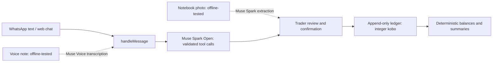

# Kobo

**you sell. kobo remembers.** WhatsApp bookkeeping for Nigerian market traders.

[Try Kobo](https://trykobo.xyz) · [Demo video — coming soon](#demo-video) · [Judging evidence](docs/JUDGING.md)

## Try it in 60 seconds

1. Open **[trykobo.xyz](https://trykobo.xyz)** and select **Your turn**.
2. Use one of the six suggestions on the site, or type one yourself:
   - `I buy 5 bag rice from Alhaji, 290k`
   - `Mama Chidi carry rice 45k, she pay 20k, remain Friday`
   - `Bayo pay me three eight`
   - `Who dey owe me`
   - `How market today?`
   - `Show Mama Chidi book`
3. Review any proposed entry. Choose **Save** only if it says what you intended; edit or cancel otherwise. Try the ambiguous `three eight` example: Kobo asks whether it means ₦3,800 or ₦38,000 instead of guessing.

**Your turn runs the real bookkeeping engine** in a private, isolated demo session with fictional seeded data. Use fictional information, not real customer records. AI replies have usage limits. The landing-page film is a scripted demonstration; Your turn is the interactive path.

WhatsApp is live on Meta's **test number**: the owner sent a text and received the real reply “Nobody owes you right now” through the deployed webhook. Meta test numbers reach only approved recipients, so **judges should use the website**. This is a single owner-verified text test, not a broad WhatsApp reliability claim.

## What Kobo does

- Turns a trader's text into a reviewable bookkeeping proposal; no money-changing entry is saved until the trader confirms it.
- Shows who owes money, customer history and a daily summary. It can prepare reminders and draft messages; a draft is not an automatically sent WhatsApp reminder.
- Supports notebook photo import and voice notes: **built and offline-tested; not yet verified live**. Review extracted names and amounts before saving.

## Meta models and the boundary

**AI interprets, trader confirms, code calculates.**

- **Live text:** Meta **Muse Spark Open**, through Vercel AI Gateway, interprets messages using validated tool calls. See [`src/server/model-provider.ts`](src/server/model-provider.ts), [`src/server/tool-calls.ts`](src/server/tool-calls.ts) and [`src/server/service.ts`](src/server/service.ts). Some explicit commands are handled deterministically without a model call.
- **Notebook photos — built and offline-tested; not yet verified live:** Muse Spark Open reads submitted images through a validated tool-call boundary: [`src/server/notebook.ts`](src/server/notebook.ts), [`src/server/service.ts`](src/server/service.ts).
- **Voice notes — built and offline-tested; not yet verified live:** Meta **Muse Voice Transcribe** transcribes audio, using the trader's own customer names as keyword hints. See [`src/server/voice/index.ts`](src/server/voice/index.ts) and [`src/server/channels/runtime.ts`](src/server/channels/runtime.ts). A voice transcript alone cannot confirm a save.
- **Deterministic money:** [`src/core/ledger.ts`](src/core/ledger.ts) and [`src/server/service.ts`](src/server/service.ts) calculate balances; [`src/server/ledger-store.ts`](src/server/ledger-store.ts) enforces the confirmation and ledger boundary.

## Evidence: live extraction evaluation

The latest documented live run passed **23 of 25 synthetic Pidgin/English cases (92.0%)**, with two failures and no errors. It was one run using in-memory databases and no confirmations. Results vary between runs; the failure causes were not captured. This is a small extraction check, **not a production accuracy or safety benchmark**. See [`docs/LIVE_EVAL_RESULTS.md`](docs/LIVE_EVAL_RESULTS.md).

## Architecture



## Built during the hackathon

Built from scratch during **26 October–4 November 2026** for the **Meta Global AI Developer Hackathon**, **Indie Developer** track, **Build for Your World** problem statement. The owner confirms nothing was pre-existing. The repository history records these milestones (the first commit visible in this repository is dated 31 October):

- **31 October:** scaffold and append-only, confirmation-gated ledger ([`2195a62`](https://github.com/emmaGH1/kobo/commit/2195a62), [`d65296f`](https://github.com/emmaGH1/kobo/commit/d65296f)).
- **1–2 November:** design direction, model tool-call boundary, voice adapter and WhatsApp channel ([`db1f01f`](https://github.com/emmaGH1/kobo/commit/db1f01f), [`5599239`](https://github.com/emmaGH1/kobo/commit/5599239), [`8526766`](https://github.com/emmaGH1/kobo/commit/8526766), [`021eac5`](https://github.com/emmaGH1/kobo/commit/021eac5)).
- **2–3 November:** isolated real-engine demo, notebook import, reminders and Your turn integration ([`7d8f705`](https://github.com/emmaGH1/kobo/commit/7d8f705), [`998c295`](https://github.com/emmaGH1/kobo/commit/998c295), [`56bf551`](https://github.com/emmaGH1/kobo/commit/56bf551), [`8b02a8a`](https://github.com/emmaGH1/kobo/commit/8b02a8a)).
- **4 November:** live-engine copy, fixes, privacy and data-deletion pages ([`c8c3d7f`](https://github.com/emmaGH1/kobo/commit/c8c3d7f), [`5aabcb6`](https://github.com/emmaGH1/kobo/commit/5aabcb6), [`ec5d8f2`](https://github.com/emmaGH1/kobo/commit/ec5d8f2)).

## Run it yourself

Requires Node.js 22, pnpm 11.11.0 and, for voice processing, FFmpeg and FFprobe. A model gateway key is required for real AI extraction; model requests may incur charges. The clone needs access to the repository.

```sh
git clone https://github.com/emmaGH1/kobo.git
cd kobo
git checkout main
corepack enable
corepack prepare pnpm@11.11.0 --activate
pnpm install --frozen-lockfile
cp .env.example .env.local
```

Edit `.env.local` privately. For the real text engine via Vercel AI Gateway set `MODEL_BASE_URL=https://ai-gateway.vercel.sh/v1`, `MODEL_ID=meta/muse-spark-open` and set `MODEL_API_KEY` to your gateway key. Never commit or share secrets. The default `.env.example` points at direct Meta instead; gateway credentials and direct Meta voice credentials may not be interchangeable.

```sh
pnpm dev
# Open http://localhost:3000 and choose Your turn.
```

`.env.example` documents every option:

| Purpose | Variables |
|---|---|
| Text model | `MODEL_BASE_URL`, `MODEL_ID`, `MODEL_API_KEY` |
| Voice | `VOICE_API_KEY`, `VOICE_PRODUCT_NAMES_JSON` (optional per-owner product hints) |
| Owner login | `OWNER_PASSCODE` (at least 12 characters) |
| Storage | `KOBO_DB_PATH`, `KOBO_AUDIO_DIR` (optional; defaults are private local paths) |
| Demo | `KOBO_DEMO_DAILY_CAP`, `KOBO_TRUST_PROXY_IP` (only enable behind the documented trusted proxy) |
| Reminder scheduler | `KOBO_REMINDER_CRON_TOKEN` |
| WhatsApp | `WHATSAPP_ACCESS_TOKEN`, `WHATSAPP_PHONE_NUMBER_ID`, `WHATSAPP_BUSINESS_ACCOUNT_ID`, `WHATSAPP_VERIFY_TOKEN`, `WHATSAPP_APP_SECRET`, `WHATSAPP_GRAPH_VERSION`, `WHATSAPP_OWNER_MAP_JSON` |

WhatsApp needs Meta setup, an approved test recipient and public HTTPS; see [`docs/WHATSAPP-SETUP.md`](docs/WHATSAPP-SETUP.md). Local demo use does not require WhatsApp credentials. Voice and notebook live behavior has not yet been verified.

Checks:

```sh
pnpm typecheck
pnpm lint
pnpm test
pnpm build
```

## Safety and privacy

Money is **integer kobo**; the ledger is **append-only**, with corrections as new events. Money-changing actions require explicit confirmation of the current pending review. Ambiguous amounts are clarified, never silently guessed. Confirmation gates financial writes, **not all storage**: submitted text and pending reviews can be stored before confirmation. See the [privacy policy](https://trykobo.xyz/privacy) and [data deletion instructions](https://trykobo.xyz/data-deletion).

## Demo video

Link coming soon.
