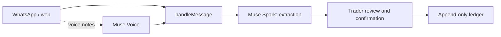

# Kobo

**you sell. kobo remembers.** WhatsApp bookkeeping for Nigerian market traders.

[Demo video — coming soon](#demo-video) · [Try it in 60 seconds](#try-it-in-60-seconds)

> **Current `main` status:** setup scaffold only. The judge chat, WhatsApp integration, AI and ledger are not yet on `main`; there is no verified public landing URL. The walkthrough and architecture below describe the intended integrated experience, not a live demo on this branch.

## Try it in 60 seconds

**Coming after integration and deployment:** open **[landing URL — to be supplied](#try-it-in-60-seconds)** → select **“Your turn”** → try a message such as:

- Pidgin: `I sell rice to Ada for 5,000 naira, she never pay.`
- English: `Ada bought rice on credit for 5,000 naira.`
- Follow up: `Who owes me?`

These are synthetic examples, not real customer records. The intended flow is to review the proposed entry and confirm it before it is saved. Judges are intended to use the web chat: WhatsApp test numbers can only reach approved numbers. The planned web and WhatsApp channels use the same bookkeeping engine; this is not yet an integrated experience on `main`.

## What Kobo does

Everything below is **coming to `main`**, not available in this checkout:

- Talk or type a sale; review it before saving.
- Ask who owes you and get payment reminders with drafted messages.
- Import a notebook photo and get a daily summary.

Some pieces exist on feature branches; branch code is not evidence that the complete judge journey is deployed or works end to end.

## How Meta's models fit

These integrations are **not on `main`**. The linked paths refer to feature branches:

- **Muse Voice:** the [voice adapter](https://github.com/emmaGH1/kobo/blob/channels/src/server/voice/index.ts) transcribes voice notes and accepts keyword hints; [channel runtime](https://github.com/emmaGH1/kobo/blob/channels/src/server/channels/runtime.ts) supplies the trader's customer names and explicitly configured, owner-scoped product names as hints.
- **Muse Spark:** the core [model provider](https://github.com/emmaGH1/kobo/blob/core/src/server/model-provider.ts) and [tool definitions](https://github.com/emmaGH1/kobo/blob/core/src/server/tool-calls.ts) support extracting stated facts via tool calling. Notebook photo reading is **coming**; it is not implemented on `main` or evidenced by the core branch here.
- **Maths is code, not the model:** [ledger calculations](https://github.com/emmaGH1/kobo/blob/core/src/core/ledger.ts) and the [bookkeeping service](https://github.com/emmaGH1/kobo/blob/core/src/server/service.ts) calculate amounts and balances deterministically.

## Live extraction evaluation

The latest documented live run on `core` passed **23 of 25 synthetic Pidgin/English cases (92.0%)**, with two failures and no errors. It was a single run with in-memory databases and no confirmations; results vary and this is **not** a production accuracy or safety benchmark. See [the authoritative results and caveats on core](https://github.com/emmaGH1/kobo/blob/core/docs/LIVE_EVAL_RESULTS.md).

## Intended architecture

This is the target flow, not a claim that it exists on `main`. Voice transcription precedes text interpretation; a ledger write follows explicit confirmation.



## Run it yourself

This starts the **setup placeholder**, not the judge chat. Prerequisites: Node.js 22 and pnpm 11.11.0. For future server-side voice processing, install FFmpeg and FFprobe as well.

```sh
git clone https://github.com/emmaGH1/kobo.git
cd kobo
git checkout main
pnpm install --frozen-lockfile
cp .env.example .env.local
pnpm dev
```

Open <http://localhost:3000>. The placeholder needs no secrets. `.env.example` lists `MODEL_API_KEY`, `OWNER_PASSCODE`, `WHATSAPP_ACCESS_TOKEN`, `WHATSAPP_PHONE_NUMBER_ID`, `WHATSAPP_BUSINESS_ACCOUNT_ID`, `WHATSAPP_VERIFY_TOKEN`, and `WHATSAPP_APP_SECRET` as empty placeholders for future integrations. Keep actual values private and never commit `.env.local`.

Checks for this checkout:

```sh
pnpm typecheck
pnpm lint
pnpm test
pnpm build
```

## Safety principles

The intended ledger uses **integer kobo**, is **append-only**, and saves no money-changing action without explicit confirmation. These are project requirements and are not yet implemented on `main`; see [agent rules](AGENTS.md) for the full invariants.

## Demo video

Link coming soon.
